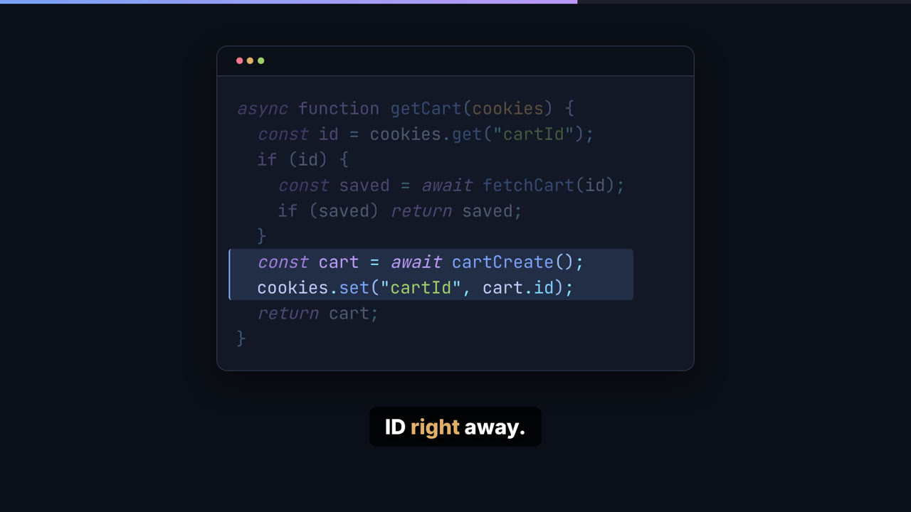
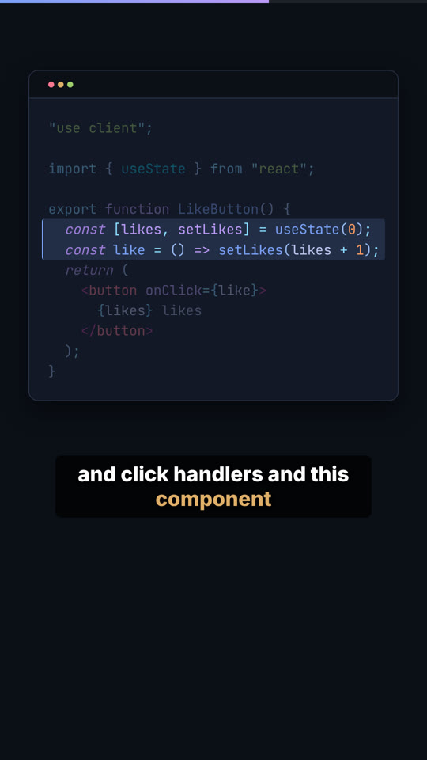

# Code Video Engine

Write a short YAML script, run one command, get a finished developer explainer video. Shorts (9:16) and long-form (16:9) come out of the same script, with narration, burned-in captions, syntax-highlighted code, a thumbnail and an `.srt` file.

Built with [Remotion](https://www.remotion.dev/), React and TypeScript.





*Stills from `scripts/shopify-storefront-cart-resets.yaml` (16:9) and `scripts/nextjs-server-vs-client-components.yaml` (9:16), rendered with the mock voice.*

## Why I built this

I like making short videos that explain one coding idea at a time. The part I don't like is the editing. Lining up code on screen with what I'm saying, nudging captions so they match the voice, re-exporting everything because I changed one sentence. A 60 second clip could eat a whole evening.

So I flipped it around. The script is the source of truth. I write what I want to say and what should be on screen, and the tool works out the timing from the generated voice. If I change a line, I run the command again and the video, captions and thumbnail all update together. No timeline, no dragging clips around.

It also keeps every video looking consistent, which is hard to do by hand. Same fonts, same colors, same pacing, and it looks right on a phone and on a desktop without me thinking about it.

## Quick start

You need Node 20.19+ (or 22.13+) and pnpm.

```bash
pnpm install
```

```bash
pnpm video render scripts/nextjs-server-vs-client-components.yaml --preset short
```

That validates the script, generates narration with the offline `mock` voice (silent audio timed from the word count), builds the manifest, and renders. Look in `out/nextjs-server-vs-client-components/`.

For a real voice, set an API key and pick a provider:

```bash
ELEVENLABS_API_KEY=... pnpm video render scripts/nextjs-server-vs-client-components.yaml --provider elevenlabs
```

## Script format

A script is a title, an optional music track, and a list of scenes. Every scene has `narration`, which is what the voice says. You never write durations: each scene lasts as long as its narration plus a short pause.

```yaml
title: Why your Shopify Storefront API cart keeps resetting

# Optional. Loops under the whole video and gets quieter while narration plays.
music:
  file: music/lofi.mp3     # relative to public/
  volume: 0.3              # optional, level in pauses (0 to 1, default 0.3)
  duckedVolume: 0.08       # optional, level under narration (default 0.08)

scenes:
  - type: title
    heading: Why your Shopify cart keeps resetting
    subheading: A Storefront API bug and the fix      # optional
    narration: You add a product, refresh, and the cart is empty again.

  - type: text
    text: An empty cart on every refresh usually means a new cart on every refresh.
    narration: Nine times out of ten, you are creating a brand new cart on every load.

  - type: code
    language: typescript
    typing: true            # optional, types the code out character by character
    code: |
      async function getCart(cookies) {
        const id = cookies.get("cartId");
        if (id) return fetchCart(id);
        return cartCreate();
      }
    highlight:              # optional, line ranges focused one after another
      - { from: 2, to: 2 }
      - { from: 3, to: 4 }
    narration: Read the cart ID from a cookie, and only create a cart when there is none.

  - type: list
    items:                  # up to 4, revealed one at a time
      - Keeping the cart ID only in React state
      - Ignoring a null cart after checkout
    narration: Watch for these two as well.

  - type: outro
    cta: Create the cart once, then reuse its ID
    narration: Follow for more Shopify developer tips.
```

| Scene    | Fields                                                                 |
| -------- | ---------------------------------------------------------------------- |
| `title`  | `heading` (80 chars), `subheading` (optional, 120 chars)               |
| `text`   | `text`: one or two short sentences (160 chars)                         |
| `code`   | `language`, `code`, `highlight` (optional), `typing` (optional)        |
| `list`   | `items`: 1 to 4 items, 60 chars each                                   |
| `outro`  | `cta`: the call to action (80 chars)                                   |

Supported code languages: `typescript`, `tsx`, `javascript`, `jsx`, `json`, `css`, `html`, `bash`, `python`, `go`, `rust`, `sql`, `yaml`.

A few rules the validator enforces, so mistakes show up before you spend time rendering:

- The file name is the slug and must be kebab-case, like `scripts/use-memo-tips.yaml`.
- Unknown fields are errors, so a typo like `hightlight` does not get silently ignored.
- Highlight ranges must point at lines that exist.
- No em dashes in on-screen text or narration. Use a comma, colon or period.
- If you set `music.file`, it has to exist under `public/`.

There are three full examples in `scripts/`:

- `example-usememo.yaml`: When NOT to use useMemo
- `nextjs-server-vs-client-components.yaml`: Server vs Client Components in Next.js App Router in 60 seconds
- `shopify-storefront-cart-resets.yaml`: Why your Shopify Storefront API cart keeps resetting

## Background music

Drop a track into `public/music/` and point `music.file` at it. The music:

- loops if it is shorter than the video,
- fades in over the first second and out over the last 1.5 seconds,
- ducks to `duckedVolume` while anyone is talking and comes back up to `volume` in pauses longer than a second, so it does not pump up and down between scenes.

The ducking is computed from the caption timings, so it follows the real narration with no extra setup. Open `MusicDuckingPreview` in Studio to see the volume curve against the narration. Use music you have the rights to; nothing in `public/music/` ships with the repo.

## Commands

| Command | What it does |
| ------- | ------------ |
| `pnpm video validate scripts/<slug>.yaml` | Checks the script and lists every problem with its location |
| `pnpm video voice scripts/<slug>.yaml --provider mock\|elevenlabs\|gemini` | Generates narration per scene into `public/audio/<slug>/` (cached, so unchanged scenes are free) |
| `pnpm video build-manifest scripts/<slug>.yaml` | Measures the audio and writes `out/<slug>/manifest.json` |
| `pnpm video render scripts/<slug>.yaml --preset short\|long` | All of the above, then renders the video, thumbnail and captions |
| `pnpm dev` | Remotion Studio, with previews of every scene, the captions and the music ducking |
| `pnpm test` | Unit tests (Vitest), all offline with the mock voice |
| `pnpm typecheck` | `tsc --noEmit` |

`render` options:

- `--preset short` (1080x1920, the default) or `--preset long` (1920x1080)
- `--provider mock` (default), `elevenlabs` or `gemini`
- `--browser-executable <path>` if Remotion cannot download Chrome on your machine (also read from `REMOTION_BROWSER_EXECUTABLE`)

API keys come from `ELEVENLABS_API_KEY` and `GEMINI_API_KEY`. Without them, use `--provider mock`.

## Output

```
out/<slug>/
  <slug>-short.mp4              the video
  <slug>-short-thumbnail.png    a still of the title scene
  <slug>.srt                    captions, chunked the same way as on screen
  manifest.json                 per-scene audio, duration and caption timings
```

## How it works

1. `validate` parses the YAML and checks it against the Zod schema in `src/schema/script.ts`.
2. `voice` turns each scene's narration into audio with the chosen TTS provider.
3. `build-manifest` measures every audio file, adds a short pause after each scene, spreads word timings across the speech for captions, and writes the manifest (`src/schema/manifest.ts`).
4. `render` hands the manifest to the Remotion composition in `src/scenes/ExplainerVideo.tsx`, which plays the scenes in order with their audio, captions, a progress bar and the background music.

Everything on screen is driven by the frame number only, so renders are repeatable.

```
src/
  schema/      script and manifest schemas
  scenes/      Title, Code, Text, List and Outro scenes
  components/  CodeBlock, TypingCode, LineHighlight, Caption, ProgressBar, BackgroundMusic
  captions/    caption timing and SRT export
  tts/         mock, ElevenLabs and Gemini voices
  cli/         the `pnpm video` commands
  theme/       colors, fonts, spacing, timing and the two presets
```
