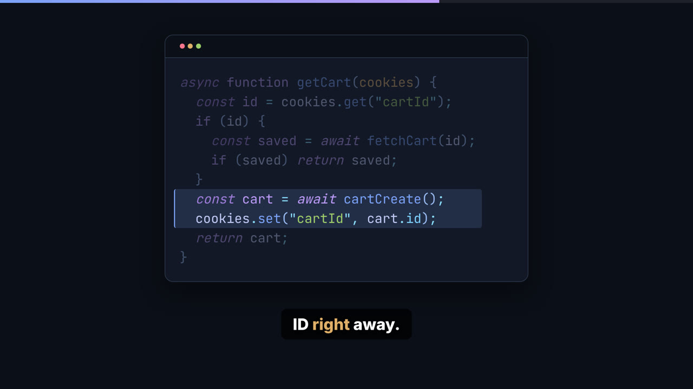
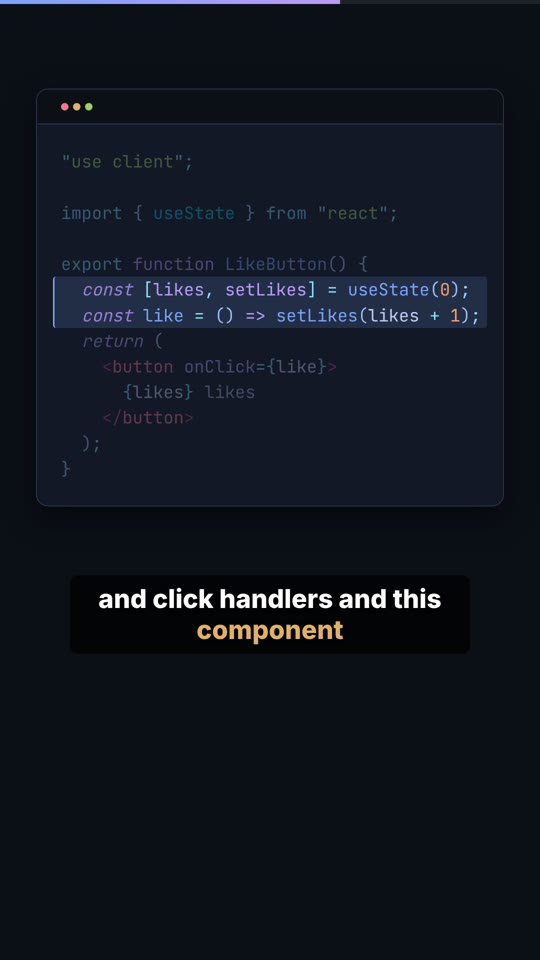

# Code Video Engine

Write a short YAML script, run one command, get a finished developer explainer video. Shorts (9:16) and long-form (16:9) come out of the same script, with narration, burned-in captions, syntax-highlighted code, a thumbnail and an `.srt` file.

Built with [Remotion](https://www.remotion.dev/), React and TypeScript. MIT licensed.





*Stills from `scripts/shopify-storefront-cart-resets.yaml` (16:9) and `scripts/nextjs-server-vs-client-components.yaml` (9:16), rendered with the mock voice.*

## Why I built this

I like making short videos that explain one coding idea at a time. The part I don't like is the editing. Lining up code on screen with what I'm saying, nudging captions so they match the voice, re-exporting everything because I changed one sentence. A 60 second clip could eat a whole evening.

So I flipped it around. The script is the source of truth. I write what I want to say and what should be on screen, and the tool works out the timing from the generated voice. If I change a line, I run the command again and the video, captions and thumbnail all update together. No timeline, no dragging clips around.

It also keeps every video looking consistent, which is hard to do by hand. Same fonts, same colors, same pacing, and it looks right on a phone and on a desktop without me thinking about it.

## Quickstart: clone to your first Short

You need [Node](https://nodejs.org/) 20.19+ (or 22.13+, which is what `.nvmrc` pins) and git. pnpm comes from Corepack, which ships with Node.

**1. Clone and install**

```bash
git clone https://github.com/Kh-Farhan/code-video-engine.git
```

```bash
cd code-video-engine
```

```bash
nvm use
```

```bash
corepack enable
```

```bash
pnpm install
```

Skip `nvm use` if you don't use nvm and your Node is already new enough. `corepack enable` gives you the exact pnpm version pinned in `package.json`.

**2. Check that everything works (optional, offline)**

```bash
pnpm typecheck && pnpm test
```

**3. Render your first Short**

```bash
pnpm video render scripts/nextjs-server-vs-client-components.yaml --preset short
```

That validates the script, generates narration, measures it, builds the manifest and renders. The first render also downloads a headless Chrome for Remotion (about 100 MB).

With no `--provider`, it uses the `mock` voice: silent audio timed from the word count. That is perfect for checking layout and timing, but the video has no speech. For a real voice for free, add `--provider kokoro`:

```bash
pnpm video render scripts/nextjs-server-vs-client-components.yaml --preset short --provider kokoro
```

**4. Find the result**

```
out/nextjs-server-vs-client-components/
  nextjs-server-vs-client-components-short.mp4              the video
  nextjs-server-vs-client-components-short-thumbnail.png    a still of the title scene
  nextjs-server-vs-client-components.srt                    captions
```

**5. Make your own**

Copy one of the examples to `scripts/<your-slug>.yaml`, edit it (see [Script format](#script-format)), then run `pnpm video validate scripts/<your-slug>.yaml` and `pnpm video render scripts/<your-slug>.yaml --provider kokoro`.

To preview while you work, run `pnpm dev`. It opens Remotion Studio at http://localhost:3000 with the full example video, each scene on its own, the caption previews and the music ducking preview.

## TTS providers

Pick one with `--provider` on `voice` or `render`. Generated audio is cached per scene in `public/audio/<slug>/`, keyed by text, voice and speed, so only scenes you changed get voiced again.

| Provider | Cost | Needs | Default voice |
| -------- | ---- | ----- | ------------- |
| `mock` (default) | Free | Nothing | Silent audio |
| `kokoro` | Free, runs locally | Nothing (one 90 MB download) | `af_heart` |
| `gemini` | Free tier, then paid | `GEMINI_API_KEY` | `Kore` |
| `elevenlabs` | Paid, small free tier | `ELEVENLABS_API_KEY` | `JBFqnCBsd6RMkjVDRZzb` |

### mock

Writes silent audio whose length is estimated from the word count. It needs no network and no key, and all tests use it. Use it to iterate on visuals quickly, then switch to a real voice for the final render.

### Kokoro (free, local)

[Kokoro](https://huggingface.co/onnx-community/Kokoro-82M-v1.0-ONNX) is an open source (Apache 2.0) voice model that runs on your own computer through `kokoro-js`. No account, no key, no rate limits.

```bash
pnpm video voice scripts/nextjs-server-vs-client-components.yaml --provider kokoro
```

The first run downloads the model once (about 90 MB, from Hugging Face). After that it works offline. Each scene takes a few seconds to voice on a laptop. This is the easiest way to get a real voice.

### Gemini

Google's Gemini speech generation. Good quality, with a free tier.

1. Create a key at https://aistudio.google.com/apikey.
2. Copy the env template: `cp .env.example .env`
3. Open `.env` and paste your key after the `=`, for example `GEMINI_API_KEY=AIza...` (no quotes, no spaces).
4. Render with `--provider gemini`.

The free tier allows only a few requests a minute and a small daily quota. When Gemini rate limits a request, the CLI waits for as long as Gemini asks and retries. A daily quota will not reset that quickly, so it stops with an error instead.

### ElevenLabs

1. Create a key at https://elevenlabs.io/app/settings/api-keys.
2. Put it in `.env` as `ELEVENLABS_API_KEY=...` (copy `.env.example` first if you haven't).
3. Render with `--provider elevenlabs`.

### API keys and `.env`

The CLI reads keys from your shell or from `.env` in the repo root. A key exported in your shell wins over `.env`. `.env` is gitignored, so keys never get committed. `.env.example` lists every variable the code reads:

| Variable | Used by |
| -------- | ------- |
| `GEMINI_API_KEY` | `--provider gemini` |
| `ELEVENLABS_API_KEY` | `--provider elevenlabs` |
| `REMOTION_BROWSER_EXECUTABLE` | Optional. A local Chrome or Chromium for rendering, same as `--browser-executable` |

### Choosing a voice and speed

Set a voice per provider in the script (see the example below), or try one for a single run without editing anything:

```bash
pnpm video voice scripts/nextjs-server-vs-client-components.yaml --provider kokoro --voice am_michael
```

To change how fast it talks, set `voice.speed` in the script (0.5 to 2, where 1 is normal and 1.15 sounds brisk), or pass `--speed 1.15` for one run. `--voice` and `--speed` win over the script.

| Provider | Voices |
| -------- | ------ |
| `kokoro` | American: `af_heart`, `af_bella`, `af_nicole`, `af_sarah`, `af_sky`, `am_michael`, `am_fenrir`, `am_puck`, `am_adam` and more. British: `bf_emma`, `bf_isabella`, `bm_george`, `bm_fable`, `bm_lewis`, `bm_daniel`. The second letter is `f` for female, `m` for male. An unknown name lists all 28. |
| `gemini` | `Kore`, `Puck`, `Charon`, `Fenrir`, `Aoede`, `Leda`, `Orus`, `Zephyr` and more; the speech generation page of the Gemini docs has samples. |
| `elevenlabs` | Voice IDs from your ElevenLabs voice library. |

## Script format

A script is a title, some optional settings, and a list of scenes. Every scene has `narration`, which is what the voice says. You never write durations: each scene lasts as long as its narration plus a short pause.

Here is a complete script using every field:

```yaml
title: Why your Shopify Storefront API cart keeps resetting

# Optional. How the video looks.
style:
  look: grid          # grid (default), aurora or classic
  captions: pop       # pop (default) or box

# Optional. Your channel handle, shown at the top and on the outro.
brand:
  handle: "@yourchannel"

# Optional. Narration voice per provider; each one names voices its own way.
voice:
  kokoro: am_michael                 # a Kokoro voice name
  gemini: Puck                       # a Gemini prebuilt voice name
  elevenlabs: 21m00Tcm4TlvDq8ikWAM   # an ElevenLabs voice ID
  speed: 1.1                         # optional, 0.5 to 2, 1 is normal

# Optional. Loops under the whole video and gets quieter while narration plays.
music:
  file: music/demo-pad.mp3   # relative to public/
  volume: 0.3                # optional, level in pauses (0 to 1, default 0.3)
  duckedVolume: 0.08         # optional, level under narration (default 0.08)

scenes:
  - type: title
    heading: Why your Shopify cart keeps resetting
    subheading: A Storefront API bug and the fix      # optional
    narration: You add a product, refresh, and the cart is empty again.

  - type: text
    text: An empty cart on every refresh usually means a new cart on every refresh.
    narration: Nine times out of ten, you are creating a brand new cart on every load.

  - type: code
    language: typescript
    typing: true            # optional, types the code out character by character
    code: |
      async function getCart(cookies) {
        const id = cookies.get("cartId");
        if (id) return fetchCart(id);
        return cartCreate();
      }
    highlight:              # optional, line ranges focused one after another
      - { from: 2, to: 2, cue: cookie }   # optional cue: starts when "cookie" is spoken
      - { from: 3, to: 4 }
    narration: Read the cart ID from a cookie, and only create a cart when there is none.

  - type: list
    items:                  # up to 4, revealed one at a time
      - Keeping the cart ID only in React state
      - Ignoring a null cart after checkout
    narration: Watch for these two as well.

  - type: outro
    cta: Create the cart once, then reuse its ID
    narration: Follow for more Shopify developer tips.
```

### Top-level fields

| Field | Required | What it is |
| ----- | -------- | ---------- |
| `title` | yes | The video title (100 chars) |
| `scenes` | yes | The scenes, played in order |
| `style` | no | `look` (`grid`, `aurora`, `classic`) and `captions` (`pop`, `box`) |
| `brand` | no | `handle`, for example `"@yourchannel"` (32 chars) |
| `voice` | no | `kokoro`, `gemini`, `elevenlabs` voice names and `speed` |
| `music` | no | `file` under `public/`, optional `volume` and `duckedVolume` |

### Scenes

| Scene    | Fields (plus `narration` on every scene)                               |
| -------- | ---------------------------------------------------------------------- |
| `title`  | `heading` (80 chars), `subheading` (optional, 120 chars)               |
| `text`   | `text`: one or two short sentences (160 chars)                         |
| `code`   | `language`, `code`, `highlight` (optional), `typing` (optional)        |
| `list`   | `items`: 1 to 4 items, 60 chars each                                   |
| `outro`  | `cta`: the call to action (80 chars)                                   |
| `compare`| `wrong` and `right`, each `{ code }` or `{ label }` (40 chars); `language` when they are code. Code is at most 6 lines of 48 chars |
| `keyword`| `keyword`: 1 to 3 words, no final punctuation (24 chars)               |
| `output` | `lines`: 1 to 6 terminal lines (60 chars), `command` and `title` optional |
| `flow`   | `steps`: 2 to 4 boxes joined by arrows (24 chars each)                 |
| `stat`   | `value` (12 chars), `label` (48 chars), `from` (optional earlier value) |

Captions already show what the voice says, so the visual should add something
the captions do not. Prefer `keyword`, `compare`, `output`, `flow` and `stat`.
Use `text` rarely: only for a short on-screen phrase that differs from the narration.

```yaml
  - type: compare
    language: tsx
    wrong: { code: "items.map((item, i) => <Row key={i} />)" }
    right: { code: "items.map((item) => <Row key={item.id} />)" }
    narration: An index key ties state to a position. Use a stable ID instead.

  - type: keyword
    keyword: STABLE ID
    narration: Give every row an identity that travels with it.

  - type: output
    command: node sort.js
    lines: ["[1, 10, 2]"]
    narration: The default sort compares strings, so ten lands before two.

  - type: flow
    steps: [Render, Hydrate]
    narration: The server renders HTML, then React hydrates it in the browser.

  - type: stat
    from: "+1"
    value: "+3"
    label: count after three clicks
    narration: With the updater function every click counts.
```

Supported code languages: `typescript`, `tsx`, `javascript`, `jsx`, `json`, `css`, `html`, `bash`, `python`, `go`, `rust`, `sql`, `yaml`.

### Validation rules

The validator catches mistakes before you spend time rendering:

- The file name is the slug and must be kebab-case, like `scripts/use-memo-tips.yaml`.
- Unknown fields are errors, so a typo like `hightlight` does not get silently ignored.
- Highlight ranges must point at lines that exist.
- A highlight `cue` must be a word (or short phrase) from that scene's narration, and cues must follow the order they are spoken in.
- No em dashes in on-screen text or narration. Use a comma, colon or period.
- If you set `music.file`, it has to exist under `public/` and be `.mp3`, `.wav`, `.m4a`, `.aac` or `.ogg`.

Every script in `scripts/` uses at least one of the visual scene types, and none rely on `text`. There are three full examples:

- `example-usememo.yaml`: When NOT to use useMemo
- `nextjs-server-vs-client-components.yaml`: Server vs Client Components in Next.js App Router in 60 seconds
- `shopify-storefront-cart-resets.yaml`: Why your Shopify Storefront API cart keeps resetting

### Highlight cues

Without cues, highlight steps split the scene evenly. Give a step a `cue` and it starts the moment that word is spoken; steps without a cue are spaced evenly between the cued ones. Matching ignores case and punctuation, so `cue: useEffect` finds `useEffect,` in the narration. A word said twice resolves to the occurrence after the previous step's cue. With `typing: true` a cue never starts a highlight before the code has finished typing. Cues follow the real voice when caption alignment is on (below) and the estimate otherwise.

## Caption timing (whisper.cpp alignment)

Captions always show the script's exact wording. Their timing comes from the audio: after TTS, `voice` runs [whisper.cpp](https://github.com/ggml-org/whisper.cpp) on each scene with token-level timestamps, and lines Whisper's words up with the narration letter by letter. So "use effect", "Array . is Array", "two" for "2" or "a thousand" for "1,000" still land on the right script word. Whisper is only used for timing, never for the text.

The result is cached in `.cache/align/` by the audio file's hash, so each audio file is transcribed once. Kokoro (kokoro-js) only gives audio per sentence, not word timestamps, so it goes through Whisper like the other providers.

Alignment is on by default for `voice` and `render` when whisper.cpp and its model are installed. `--no-align` turns it off; `--align` asks for it explicitly. When it cannot run (not installed, mock audio, an error, or a transcription that does not match the narration) the scene falls back to the word-length estimate and a `WARNING:` line says why.

### Install whisper.cpp

```bash
pnpm video whisper-setup
```

This uses Remotion's `installWhisperCpp` and `downloadWhisperModel` to build whisper.cpp 1.7.6 into `./whisper.cpp` and download the `base.en` model (about 140 MB). Both are gitignored. On macOS it needs the Xcode command line tools (`xcode-select --install`) and cmake (`brew install cmake`); on Apple Silicon the build uses Metal automatically.

Override with `WHISPER_CPP_PATH` (folder), `WHISPER_CPP_VERSION` and `WHISPER_MODEL` (for example `small.en` for harder audio), in the shell or `.env`.

## Look and feel

- **Looks.** `grid` is a floor grid rolling toward the viewer under a glowing horizon, with drifting light and floating particles. `aurora` is soft blue, purple and teal light drifting behind everything. `classic` is the original static navy. The background is drawn once behind the whole video, so its motion carries straight through scene changes.
- **Captions.** `pop` shows big outlined words two to four at a time, and the word being spoken pops in yellow: the usual Shorts and Reels style. `box` is a calmer subtitle box with up to six words.
- **Brand.** With a `handle`, a small pill shows it at the top of the video (top center on vertical video, clear of the buttons Shorts, Reels and Facebook draw in the corners) and the outro adds "Follow @yourchannel".
- **Motion.** Titles and calls to action come in word by word, and scenes change with a quick zoom and blur instead of a plain fade. Code punches in a little on the active highlight and bumps on each new step; code without highlights drifts in slowly.
- **Layout.** Scene visuals stay in the top visual zone (`layoutZones` in `src/theme`) and leave the caption band below free.

In Studio, the `CaptionPreview-pop-*` and `CaptionPreview-box-*` compositions show each caption style.

## Background music

Drop a track into `public/music/` and point `music.file` at it. The music:

- loops if it is shorter than the video,
- fades in over the first second and out over the last 1.5 seconds,
- ducks to `duckedVolume` while anyone is talking and comes back up to `volume` in pauses longer than a second, so it does not pump up and down between scenes.

The ducking is computed from the caption timings, so it follows the real narration with no extra setup. Open `MusicDuckingPreview` in Studio to see the volume curve against the narration.

`public/music/demo-pad.mp3` is a calm 65 second chord loop generated for this repo, so you can try music right away (the Next.js example uses it). Replace it with any track you have the rights to. If the music is hard to hear under the voice, raise `duckedVolume` a little, for example to `0.12`.

## Commands

### `pnpm video`

| Command | What it does |
| ------- | ------------ |
| `pnpm video validate scripts/<slug>.yaml` | Checks the script and lists every problem with its location |
| `pnpm video voice scripts/<slug>.yaml` | Validates, then generates narration per scene into `public/audio/<slug>/` (cached) |
| `pnpm video build-manifest scripts/<slug>.yaml` | Validates, reads the existing audio, measures it and writes `out/<slug>/manifest.json`. Run `voice` first |
| `pnpm video render scripts/<slug>.yaml` | All of the above, then renders the video, thumbnail and captions |
| `pnpm video metadata scripts/<slug>.yaml` | Writes `out/<slug>/upload.md`: 3 YouTube titles under 60 characters, a description, 5 to 8 hashtags (always `#shorts`) and the full transcript. Template-based, no API calls |
| `pnpm video metadata --all` | The same for every script in `scripts/` |
| `pnpm video whisper-setup` | Installs whisper.cpp and the alignment model into `./whisper.cpp` |
| `pnpm video --help` | Prints usage |

Options:

| Option | Commands | What it does |
| ------ | -------- | ------------ |
| `--provider mock\|kokoro\|elevenlabs\|gemini` | `voice`, `render` | TTS provider. Default `mock` |
| `--voice <name>` | `voice`, `render` | Voice for this run. Overrides the script's `voice` |
| `--speed <n>` | `voice`, `render` | Speaking speed, 0.5 to 2. Overrides `voice.speed` |
| `--align`, `--no-align` | `voice`, `render` | Time captions from the audio with whisper.cpp. On by default when installed; falls back to estimated timing with a warning |
| `--preset short\|long` | `render` | `short` is 1080x1920 (default), `long` is 1920x1080 |
| `--all` | `metadata` | Run for every `.yaml` script in `scripts/` instead of one path |
| `--browser-executable <path>` | `render` | Local Chrome or Chromium, if Remotion cannot download one. Also read from `REMOTION_BROWSER_EXECUTABLE` |

### Project scripts

| Command | What it does |
| ------- | ------------ |
| `pnpm dev` | Remotion Studio, with previews of every scene, the captions and the music ducking |
| `pnpm test` | Unit tests (Vitest), all offline with the mock voice |
| `pnpm typecheck` | `tsc --noEmit` |

## Output

```
public/audio/<slug>/            generated narration per scene, plus voice.json
out/<slug>/
  <slug>-short.mp4              the video (or <slug>-long.mp4)
  <slug>-short-thumbnail.png    a still of the title scene
  <slug>.srt                    captions, chunked the same way as on screen
  manifest.json                 per-scene audio, duration and caption timings
  upload.md                     titles, description, hashtags and transcript (from `metadata`)
```

Both folders are gitignored.

## How it works

1. `validate` parses the YAML and checks it against the Zod schema in `src/schema/script.ts`.
2. `voice` turns each scene's narration into audio with the chosen TTS provider, then aligns word timings to it with whisper.cpp (`src/align/`) when available.
3. `build-manifest` measures every audio file, adds a short pause after each scene, uses the aligned word timings (or spreads estimated ones across the speech), and writes the manifest (`src/schema/manifest.ts`).
4. `render` hands the manifest to the Remotion composition in `src/scenes/ExplainerVideo.tsx`, which plays the scenes in order with their audio, captions, a progress bar and the background music.

Everything on screen is driven by the frame number only, so renders are repeatable.

```
src/
  schema/      script and manifest schemas
  scenes/      Title, Code, Text, List and Outro scenes
  components/  CodeBlock, TypingCode, LineHighlight, Caption, ProgressBar, BackgroundMusic, Backdrop, BrandHandle
  captions/    caption timing and SRT export
  tts/         mock, Kokoro, ElevenLabs and Gemini voices
  cli/         the `pnpm video` commands
  metadata/    upload titles, description, hashtags and transcript
  theme/       colors, fonts, spacing, timing and the two presets
```

## Troubleshooting

**The video has no voice.** You rendered with the default `mock` provider, which makes silent audio on purpose. Add `--provider kokoro` (free) or another provider.

**`pnpm: command not found`.** Run `corepack enable`, then open a new terminal. Or install pnpm with `npm install -g pnpm`.

**Node version errors during install or `process.loadEnvFile is not a function`.** Your Node is too old. Use Node 20.19+ or 22.13+ (`nvm use` picks the right one from `.nvmrc`).

**`gemini: GEMINI_API_KEY is not set` (or the ElevenLabs one).** Make sure `.env` sits in the repo root (next to `package.json`), the line looks like `GEMINI_API_KEY=AIza...` with no quotes or spaces, and you run `pnpm video` from the repo root. An empty variable exported in your shell also wins over `.env`, so `unset GEMINI_API_KEY` if needed.

**Gemini keeps waiting or says the quota is used up.** The free tier allows a few requests a minute and a small daily quota. The CLI waits and retries on per-minute limits. For a daily limit, wait until tomorrow, or switch to `--provider kokoro`. Scenes that were already voiced stay cached either way.

**Kokoro is slow the first time or fails to download.** The first run fetches about 90 MB from Hugging Face, so it needs network access to `huggingface.co` once. After that it runs offline.

**Render fails while downloading Chrome.** Remotion downloads its own headless browser on the first render. If that is blocked (proxy, firewall, unsupported OS), install Chrome or Chromium and pass `--browser-executable /path/to/chrome`, or set `REMOTION_BROWSER_EXECUTABLE` in `.env`.

**`build-manifest` complains about missing audio.** It only measures audio that exists. Run `pnpm video voice ...` first, or use `render`, which does every step.

**The validator rejects my script.** It prints every problem with its location, like `scenes[2].highlight[0]`. The usual causes are a typo in a field name, an em dash in narration, text over the character limit, or a highlight range past the last line of code.

**I changed the voice but it sounds the same.** Check that the voice is set for the provider you are using (`voice.kokoro` for Kokoro, and so on), or pass `--voice`. To force every scene to be voiced again, delete `public/audio/<slug>/`.

## License

[MIT](LICENSE) © Farhan
